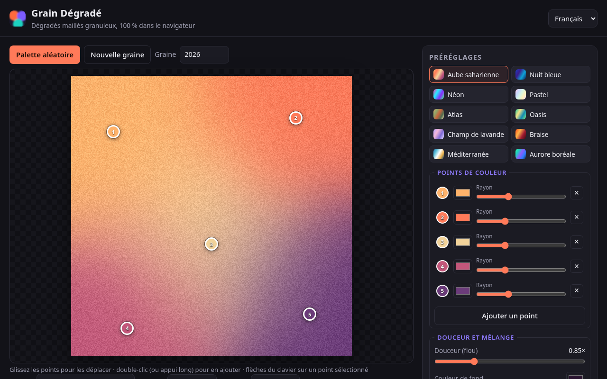
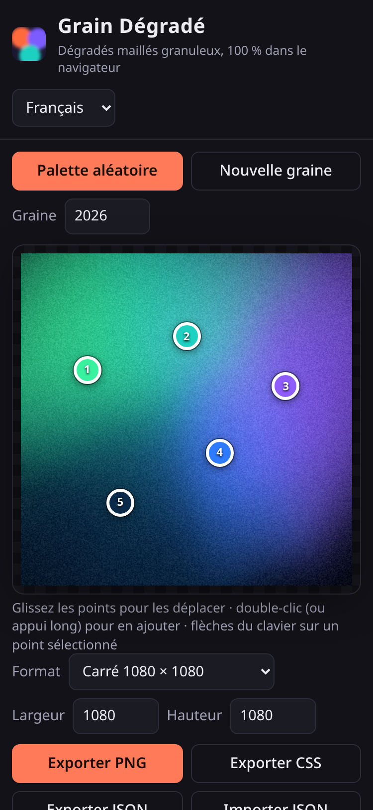

# Grain Dégradé

**FR** — Générateur libre de **dégradés maillés granuleux** (« mesh gradient » + grain), ces fonds doux, bruités et lumineux très utilisés en design graphique, UI et réseaux sociaux. Tout se fait dans le navigateur : aucun logiciel à installer, aucune image envoyée, aucune clé d'API.

👉 **Démo : https://salimadour31-boop.github.io/grain-degrade/**

## Fonctionnalités

- **3 à 8 points de couleur déplaçables** directement sur l'aperçu (souris, tactile ou clavier), avec pour chacun une couleur et un rayon.
- Ajout d'un point par **double-clic** (ou appui long sur mobile), suppression par le bouton × ou la touche Suppr.
- **Douceur** (flou global), **couleur et présence du fond**, **ondulation** organique pour un rendu « aurore ».
- Mélange des couleurs **perceptuel (OKLab)**, sans zones grisâtres, ou RVB linéaire.
- **Grain procédural** : quantité et taille réglables.
- Retouches : **contraste, saturation, luminosité, vignette**.
- **10 préréglages originaux** : Aube saharienne, Nuit bleue, Néon, Pastel, Atlas, Oasis, Champ de lavande, Braise, Méditerranée, Aurore boréale — et un bouton **palette aléatoire** harmonieuse.
- **Formats** : carré 1080, story 1080 × 1920, A4 portrait (2480 × 3508, 300 dpi), 16:9 1920 × 1080, ou taille personnalisée (64 à 6000 px).
- **Exports** : PNG en pleine résolution, **CSS** approché (pile de `radial-gradient` + grain SVG optionnel, avec aperçu), **JSON** des réglages ; **import JSON**.
- **Graine** : le même réglage donne toujours exactement la même image.
- **Lien partageable** : tous les réglages sont enregistrés dans l'adresse de la page (`#s=…`).
- Interface **français / English / Taqbaylit**, mémorisée sur l'appareil ; responsive (bureau, tablette, mobile) et accessible (libellés, clavier).

## Utilisation

1. Ouvrez la [démo](https://salimadour31-boop.github.io/grain-degrade/) (ou `index.html` en local, sans serveur ni installation).
2. Choisissez un préréglage ou cliquez sur **Palette aléatoire**.
3. Déplacez les points sur l'aperçu, changez leurs couleurs et rayons, ajustez douceur, ondulation et grain.
4. Choisissez le format, puis **Exporter PNG**. Pour un site web, **Exporter CSS** donne une version légère approchée.
5. **Copier le lien** ou **Exporter JSON** pour retrouver ou partager exactement le même dégradé.

Astuce : double-clic sur un curseur = valeur par défaut. Sur un point sélectionné, les flèches le déplacent (Maj + flèche = pas plus grand).

## Comment ça marche

Chaque pixel reçoit une moyenne des couleurs des points, pondérée par une gaussienne de la distance (rayon × douceur), plus un poids constant pour la couleur de fond. Le mélange est calculé dans l'espace OKLab. Les coordonnées sont légèrement déformées par un bruit basse fréquence (ondulation), puis un grain monochrome issu d'un bruit procédural (graine reproductible) est ajouté. L'aperçu est calculé à la taille de l'écran ; l'export PNG refait le calcul à la taille finale.

| Fichier | Rôle |
|---|---|
| `index.html` | Page et structure de l'interface |
| `styles.css` | Thème sombre et mise en page responsive |
| `gradient.js` | Moteur de rendu (dégradé, OKLab, ondulation, grain, palettes aléatoires, export CSS) |
| `app.js` | Interface : points, réglages, préréglages, exports, lien partageable |
| `i18n.js` | Traductions FR / EN / Taqbaylit |

## Limites connues

- L'export CSS est une **approximation** (dégradés radiaux superposés) : il ne reproduit ni l'ondulation ni exactement le mélange OKLab. Le PNG est la référence.
- Le grain de l'aperçu est calculé à la résolution de l'écran ; il est plus fin dans l'export PNG pleine taille.
- Les très grands formats (ex. 6000 × 6000) peuvent prendre quelques secondes à exporter sur un appareil modeste.

## Contribuer

Les corrections (notamment des **traductions en taqbaylit**, à améliorer volontiers) et les nouveaux préréglages sont les bienvenus via issue ou pull request.

---

## English

**Grain Dégradé** is a free, open-source **grainy mesh-gradient generator** that runs entirely in the browser. Drag 3–8 colour points on the canvas, tune softness, warp, background, OKLab/RGB blending, procedural grain, contrast, saturation, brightness and vignette, pick one of 10 original presets or a random harmonious palette, then export a full-resolution **PNG**, an approximate **CSS** stack of radial gradients (with optional SVG grain) or a **JSON** settings file. Results are reproducible thanks to a seed, and settings can be shared through the URL hash. UI in French, English and Taqbaylit. No install, no upload, no API key.

Demo: https://salimadour31-boop.github.io/grain-degrade/

## Licence

[MIT](LICENSE) © 2026 Amirouche Amwanes. Code, logo, presets and palettes are original; no third-party assets.
